# Aplikasi Web "Moodle"


## Sekilas Tentang

Moodle adalah Learning Management System (LMS) gratis dan open-source yang dikembangkan oleh Martin Dougiamas menggunakan bahasa pemrograman PHP dan didistribusikan berdasarkan GNU General Public License (GNU GPL). Moodle digunakan untuk menyediakan lingkungan pembelajaran daring yang terpadu bagi pendidik, administrator, serta peserta didik. Versi pertama Moodle dirilis pada 20 Agustus 2002 dan pengembangannya masih terus dilakukan secara aktif di bawah Moodle HQ. Aplikasi Moodle disediakan gratis untuk Android dan iOS.

Pada proyek ini Moodle **5.2.4** dipasang secara manual (tanpa Docker) di dua lingkungan: VM lokal (VirtualBox) dan VPS yang dapat diakses dari internet di **https://moodle-kdjk2.my.id**.

## Instalasi

Moodle dipasang di dua lingkungan: **VM lokal (VirtualBox)** sebagai dasar, kemudian **VPS** agar dapat diakses dari internet. Langkah di VPS banyak yang sama dengan VM lokal; perbedaan utamanya ada pada domain, HTTPS, dan firewall cloud. Nomor build Moodle kedua lingkungan berbeda (VM lokal Build 20261005, VPS Build 20261013) karena `git clone` cabang `MOODLE_502_STABLE` dilakukan pada waktu yang berbeda, bukan karena kesalahan.

### Instalasi Manual di VM Lokal (VirtualBox)

**Prasyarat**

- **Host:** laptop Windows dengan RAM 16 GB dan Oracle VirtualBox
- **Spesifikasi VM:** 2 vCPU, 4096 MB RAM, disk virtual 30 GB (VDI)
- **Sistem Operasi:** Ubuntu Server 24.04.5 LTS (Noble Numbat), dari ISO `ubuntu-24.04.5-live-server-amd64.iso`
- **Jaringan VM:** NAT dengan port forwarding `2222 → 22` (SSH), `8080 → 80` (HTTP), dan `8443 → 443` (HTTPS)
- **Web Server:** Apache/2.4.58 (Ubuntu)
- **Database Server:** MariaDB Server 10.11.14
- **Bahasa Pemrograman / Runtime:** PHP 8.3.6 (OPcache aktif)
- **Versi Moodle:** 5.2.4 (Build: 20261005), cabang `MOODLE_502_STABLE`
- **Alamat Akses:** `http://localhost:8080` (dari laptop host)

Ubuntu 24.04 LTS menyediakan PHP 8.3 dan MariaDB 10.11 dari repositori bawaan. Keduanya sesuai dengan syarat yang ditampilkan cek server Moodle (PHP minimal 8.3.0 dan MariaDB minimal 10.11.0).

**Proses Instalasi**

1. Buat VM di VirtualBox. Klik **New**, beri nama `moodle-server`, pilih file ISO Ubuntu Server, lalu atur Base Memory 4096 MB, 2 CPU, dan disk virtual 30 GB berformat VDI tanpa *Pre-allocate Full Size*. Lepaskan centang *Proceed with Unattended Installation* agar installer dijalankan secara manual, dan biarkan *Use EFI* tidak dicentang.

2. Sebelum VM dinyalakan, buka **Settings > Network > Adapter 1 > Port Forwarding** dan tambahkan tiga aturan berikut (kolom Guest IP dikosongkan).

   | Nama | Protokol | Host Port | Guest Port |
   | :--- | :--- | :--- | :--- |
   | SSH | TCP | 2222 | 22 |
   | HTTP | TCP | 8080 | 80 |
   | HTTPS | TCP | 8443 | 443 |

3. Nyalakan VM dan ikuti installer Ubuntu Server. Kosongkan proxy, pakai mirror `http://id.archive.ubuntu.com/ubuntu/`, isi profil (nama server `moodle`, user `adminmoodle`), centang **Install OpenSSH server**, dan jangan pilih *featured server snaps*. Setelah instalasi selesai, pilih **Reboot Now** sampai muncul prompt `moodle login:`.

4. Jendela VM tidak mendukung *paste*, jadi perintah selanjutnya dijalankan lewat **PowerShell di Windows**. Masuk ke VM lewat SSH, lalu perbarui sistem.
   ```powershell
   ssh -p 2222 adminmoodle@127.0.0.1
   ```
   ```bash
   sudo apt update && sudo apt upgrade -y
   ```

5. Perbesar partisi root. Installer hanya memakai separuh disk virtual: volume `ubuntu-lv` terlihat 14 GiB, dan setelah diperbesar menjadi 28 GiB.
   ```bash
   sudo lvs
   sudo vgs
   sudo lvextend -r -l +100%FREE /dev/ubuntu-vg/ubuntu-lv
   df -h /
   ```

6. Pasang Apache, MariaDB, PHP 8.3, dan ekstensi yang dibutuhkan Moodle, lalu cek versinya.
   ```bash
   sudo apt install -y apache2 mariadb-server libapache2-mod-php \
       php php-cli php-mysql php-curl php-gd php-intl php-mbstring php-xml php-zip php-soap \
       unzip git curl
   php -v
   apache2 -v
   mariadb --version
   ```

7. Amankan MariaDB, lalu buat database dan user khusus Moodle dengan hak terbatas. Jalankan perintah SQL **satu per satu**; jika beberapa baris di-*paste* sekaligus, perintah dapat menempel dan tidak dijalankan.
   ```bash
   sudo mysql_secure_installation
   sudo mariadb
   ```
   ```sql
   CREATE DATABASE moodle DEFAULT CHARACTER SET utf8mb4 COLLATE utf8mb4_unicode_ci;
   CREATE USER 'moodleuser'@'localhost' IDENTIFIED BY '<password>';
   GRANT SELECT,INSERT,UPDATE,DELETE,CREATE,CREATE TEMPORARY TABLES,DROP,INDEX,ALTER ON moodle.* TO 'moodleuser'@'localhost';
   FLUSH PRIVILEGES;
   EXIT;
   ```
   Uji login user baru. Hasil yang benar: daftar berisi `information_schema` dan `moodle`.
   ```bash
   mariadb -u moodleuser -p -e "SHOW DATABASES;"
   ```

8. Unduh Moodle lewat git dan buat direktori `moodledata` di luar *document root*.
   ```bash
   sudo git clone --depth 1 --branch MOODLE_502_STABLE https://github.com/moodle/moodle.git /var/www/moodle
   grep -E "release|version " /var/www/moodle/public/version.php
   sudo mkdir /var/moodledata
   sudo chown -R www-data:www-data /var/moodledata
   sudo chmod 770 /var/moodledata
   ```

9. Sesuaikan konfigurasi PHP untuk Apache dan CLI.
   ```bash
   sudo bash -c 'printf "max_input_vars = 5000\nupload_max_filesize = 100M\npost_max_size = 100M\nmemory_limit = 256M\n" > /etc/php/8.3/apache2/conf.d/99-moodle.ini'
   sudo cp /etc/php/8.3/apache2/conf.d/99-moodle.ini /etc/php/8.3/cli/conf.d/99-moodle.ini
   ```

10. Arahkan Apache ke folder `public`. Port 8080 ikut didengarkan di dalam VM agar alamat situs `http://localhost:8080` juga terjangkau dari dalam VM.
    ```bash
    sudo tee /etc/apache2/sites-available/moodle.conf > /dev/null <<'EOF'
    <VirtualHost *:80 *:8080>
        ServerName localhost
        DocumentRoot /var/www/moodle/public
        <Directory /var/www/moodle/public>
            AllowOverride None
            Require all granted
            DirectoryIndex index.php
            FallbackResource /r.php
        </Directory>
        ErrorLog ${APACHE_LOG_DIR}/moodle_error.log
        CustomLog ${APACHE_LOG_DIR}/moodle_access.log combined
    </VirtualHost>
    EOF
    grep -q "Listen 8080" /etc/apache2/ports.conf || echo "Listen 8080" | sudo tee -a /etc/apache2/ports.conf
    sudo a2dissite 000-default
    sudo a2ensite moodle
    sudo apache2ctl configtest
    sudo systemctl restart apache2
    ```

11. Pasang dependensi Composer. Cek server Moodle menampilkan peringatan "Composer installed data not found" karena unduhan lewat git tidak menyertakan folder `vendor`.
    ```bash
    sudo apt install -y composer
    sudo chown www-data:www-data /var/www/moodle
    cd /var/www/moodle
    sudo -u www-data env COMPOSER_HOME=/tmp/composer composer install --no-dev --classmap-authoritative
    ls /var/www/moodle/vendor
    ```
    Perintah `chown` pada folder `/var/www/moodle` (tanpa `-R`) juga memberi izin tulis sementara agar installer web pada langkah 12 dapat membuat `config.php`.

12. Jalankan installer Moodle lewat browser di `http://localhost:8080/install.php`.
    - **Konfirmasi jalur:** alamat web `http://localhost:8080`, direktori Moodle `/var/www/moodle`, dan direktori data `/var/moodledata`, yaitu folder yang dibuat pada langkah 8 (nilai bawaan installer menunjuk `/var/www/moodledata`).
    - **Driver basis data:** MariaDB (native/mariadb).
    - **Pengaturan basis data:** host `localhost`, nama `moodle`, pengguna `moodleuser`, kata sandi milik `moodleuser`, prefiks `mdl_`, port dan soket dikosongkan.
    - **Lisensi:** lanjutkan setelah membaca ketentuan GNU GPL v3.
    - **Cek server:** semua baris pada tabel "Cek server" berstatus OK. Bagian "Cek lainnya" masih menampilkan peringatan router dan HTTPS (peringatan Composer hilang setelah langkah 11).
    - **Akun admin:** isi nama pengguna, kata sandi yang kuat, surel, negara, dan zona waktu.
    - **Setelan beranda situs:** isi nama situs, pilih zona waktu bawaan `Asia/Jakarta`, dan biarkan pendaftaran mandiri **Nonaktif**.

    Setelah disimpan, dashboard terbuka di `http://localhost:8080/my/` dengan tulisan "Selamat datang, Admin!".

13. Perbaiki router Moodle. Halaman **Administrasi situs > Laporan > Status** awalnya menampilkan "Konfigurasi router: Galat". Tambahkan flag di `config.php`, lalu bungkus `SetHandler` PHP dengan kondisi file benar-benar ada.
    ```bash
    sudo sed -i '/lib\/setup.php/i $CFG->routerconfigured = true;' /var/www/moodle/config.php
    sudo cp /etc/apache2/mods-available/php8.3.conf /root/php8.3.conf.bak
    sudo sed -i 's|^\(\s*\)SetHandler application/x-httpd-php$|\1<If "-f %{REQUEST_FILENAME}">\n\1    SetHandler application/x-httpd-php\n\1</If>|' /etc/apache2/mods-available/php8.3.conf
    sudo apache2ctl configtest
    sudo systemctl restart apache2
    ```
    Berkas `php8.3.conf` diduga milik paket `libapache2-mod-php8.3`, sehingga setelah `apt upgrade` perubahan ini perlu dicek ulang (lihat bagian Maintenance).

14. Pasang cron Moodle agar tugas terjadwal berjalan tiap menit.
    ```bash
    echo "* * * * * /usr/bin/php /var/www/moodle/admin/cli/cron.php >/dev/null" | sudo crontab -u www-data -
    sudo crontab -u www-data -l
    ```

15. Verifikasi dari terminal VM.
    ```bash
    curl -sI http://localhost:8080/ | head -1
    curl -sI http://localhost:8080/lib/exampleshimroute2.php | head -1
    curl -sI http://localhost:8080/not/a/valid/request | head -1
    ```
    Hasil yang terlihat: `HTTP/1.1 303 See Other` (pengalihan dari Moodle), `HTTP/1.1 302 Found`, dan `HTTP/1.1 404 Not Found`. Halaman Status Moodle menampilkan Lingkungan, Peningkatan, Konfigurasi router, dan Cron berjalan berstatus **OK**, sedangkan Antivirus **N/A** karena tidak ada pemindai yang diaktifkan.

> **Catatan VM lokal.** HTTPS tidak dipasang di VM lokal, sehingga alamat situs tetap `http://localhost:8080`. Hal-hal berikut belum dicek ulang pada VM lokal: isi `dataroot` di `config.php`, pemasangan crontab beserta tes manualnya (`sudo -u www-data /usr/bin/php /var/www/moodle/admin/cli/cron.php`), penguncian izin kode (`chown -R root:root /var/www/moodle`), `ServerName` global Apache (peringatan `AH00558` masih muncul), dan pembatasan Host IP port forwarding ke `127.0.0.1`.

### Instalasi di VPS (Helipod)

**Prasyarat**

- **Penyedia VPS:** Helipod (Region: ap-jakarta, Indonesia)
- **Spesifikasi VPS:** 2 vCPU, 4 GB RAM, 60 GB SSD
- **Domain Aktif:** `moodle-kdjk2.my.id` (A Record: `43.173.53.5`), `www.moodle-kdjk2.my.id`
- **Sistem Operasi:** Ubuntu 24.04.4 LTS (Noble Numbat - 64-bit)
- **Cloud Firewall Helipod:** Port 22 (SSH), Port 80 (HTTP), dan Port 443 (HTTPS). Aturan port 443 harus ditambahkan manual karena bawaan hanya SSH, HTTP, dan Ping.
- **Login SSH:** public key ED25519 sudah terpasang. Login password SSH **masih aktif** dan firewall di dalam server (UFW) **belum diaktifkan**; perlindungan port saat ini hanya dari Cloud Firewall Helipod (lihat bagian Maintenance).
- **Web Server:** Apache/2.4.58 (Ubuntu)
- **Database Server:** MariaDB Server 10.11.14
- **Bahasa Pemrograman / Runtime:** PHP 8.3.6 (NTS, OPcache aktif)
- **Versi Moodle:** 5.2.4+ (Build: 20261013), cabang `MOODLE_502_STABLE`

**Proses Instalasi**

1. Login ke server lewat SSH sebagai user `ubuntu` (user bawaan image Ubuntu di Helipod). Pada login pertama, SSH menampilkan fingerprint host. Cocokkan dengan fingerprint ED25519 server `SHA256:aYWZ+J1qLLF10GzNqsesyJmX+0mUz2lcXLcjKmhOw30` sebelum menjawab `yes`.
   ```bash
   ssh ubuntu@moodle-kdjk2.my.id
   ```
2. Atur zona waktu ke WIB dan perbarui seluruh paket sistem.
   ```bash
   sudo timedatectl set-timezone Asia/Jakarta
   sudo apt update && sudo DEBIAN_FRONTEND=noninteractive apt upgrade -y
   ```
3. Pasang paket LAMP stack serta dependensi lengkap Moodle.
   ```bash
   sudo DEBIAN_FRONTEND=noninteractive apt install -y \
       apache2 mariadb-server libapache2-mod-php \
       php php-cli php-mysql php-curl php-gd php-intl \
       php-mbstring php-xml php-zip php-soap \
       unzip git curl composer certbot python3-certbot-apache
   ```
4. Konfigurasi ServerName global pada Apache untuk menghilangkan peringatan `AH00558`.
   ```bash
   echo "ServerName localhost" | sudo tee /etc/apache2/conf-available/servername.conf
   sudo a2enconf servername
   sudo systemctl reload apache2
   ```
5. Terapkan hardening pada MariaDB secara otomatis.
   ```bash
   sudo mariadb << 'EOSQL'
   DELETE FROM mysql.user WHERE User='';
   DELETE FROM mysql.user WHERE User='root' AND Host NOT IN ('localhost', '127.0.0.1', '::1');
   DROP DATABASE IF EXISTS test;
   DELETE FROM mysql.db WHERE Db='test' OR Db='test\\_%';
   FLUSH PRIVILEGES;
   EOSQL
   ```
6. Buat kredensial acak untuk database dan admin Moodle, lalu simpan di berkas yang hanya dapat dibaca root. Tidak ada kata sandi yang ditulis langsung (*hardcode*) di perintah maupun di repositori ini. Kata sandi admin pada server ini berawalan tetap `Moodle2026!` yang diikuti 16 karakter heksadesimal acak. Awalan tetap melemahkan keacakan, sehingga untuk pemakaian ulang sebaiknya memakai generator acak penuh seperti pada skrip `install-moodle.sh`.
   ```bash
   DB_PASS=$(openssl rand -hex 16)
   ADMIN_PASS="Moodle2026!$(openssl rand -hex 8)"

   sudo tee /root/moodle-credentials.txt << EOC
   DB_NAME=moodle
   DB_USER=moodleuser
   DB_PASS=${DB_PASS}
   ADMIN_USER=admin
   ADMIN_PASS=${ADMIN_PASS}
   EOC
   sudo chmod 600 /root/moodle-credentials.txt
   sudo chown root:root /root/moodle-credentials.txt
   ```
   Variabel `DB_PASS` dan `ADMIN_PASS` hanya hidup selama sesi terminal yang sama. Jika sesi terputus sebelum langkah 15, muat ulang nilainya dari berkas kredensial.
   ```bash
   DB_PASS=$(sudo grep '^DB_PASS=' /root/moodle-credentials.txt | cut -d= -f2-)
   ADMIN_PASS=$(sudo grep '^ADMIN_PASS=' /root/moodle-credentials.txt | cut -d= -f2-)
   ```
7. Buat database dengan encoding `utf8mb4` dan user dengan hak terbatas (prinsip *least privilege*):
   ```bash
   sudo mariadb -e "CREATE DATABASE IF NOT EXISTS moodle DEFAULT CHARACTER SET utf8mb4 COLLATE utf8mb4_unicode_ci;"
   sudo mariadb -e "CREATE USER IF NOT EXISTS 'moodleuser'@'localhost' IDENTIFIED BY '${DB_PASS}';"
   sudo mariadb -e "GRANT SELECT,INSERT,UPDATE,DELETE,CREATE,CREATE TEMPORARY TABLES,DROP,INDEX,ALTER ON moodle.* TO 'moodleuser'@'localhost';"
   sudo mariadb -e "FLUSH PRIVILEGES;"
   ```
8. Unduh Moodle cabang stabil 5.2 (bukan LTS) lewat git.
   ```bash
   sudo git clone --depth 1 --branch MOODLE_502_STABLE https://github.com/moodle/moodle.git /var/www/moodle
   ```
9. Buat direktori `moodledata` di luar *document root* web agar berkas materi dan tugas tidak bisa diakses langsung dari internet.
   ```bash
   sudo mkdir -p /var/moodledata
   sudo chown -R www-data:www-data /var/moodledata
   sudo chmod 770 /var/moodledata
   ```
10. Pasang dependensi PHP dengan Composer. Moodle 5.1 ke atas mewajibkan folder `vendor`, yang tidak ikut terunduh lewat `git clone`.
    ```bash
    sudo chown -R www-data:www-data /var/www/moodle
    cd /var/www/moodle
    sudo -u www-data env COMPOSER_HOME=/tmp/composer composer install --no-dev --classmap-authoritative
    ```
11. Sesuaikan konfigurasi PHP untuk batas variabel formulir dan kuota berkas.
    ```bash
    sudo tee /etc/php/8.3/apache2/conf.d/99-moodle.ini << 'EOF'
    max_input_vars = 5000
    upload_max_filesize = 100M
    post_max_size = 100M
    memory_limit = 256M
    EOF
    sudo cp /etc/php/8.3/apache2/conf.d/99-moodle.ini /etc/php/8.3/cli/conf.d/99-moodle.ini
    ```
12. Buat VirtualHost Apache yang mengarah ke direktori `/public`.
    ```bash
    sudo tee /etc/apache2/sites-available/moodle.conf << 'EOF'
    <VirtualHost *:80>
       ServerName moodle-kdjk2.my.id
       ServerAlias www.moodle-kdjk2.my.id
       DocumentRoot /var/www/moodle/public
       <Directory /var/www/moodle/public>
           AllowOverride None
           Require all granted
           DirectoryIndex index.php
           FallbackResource /r.php
       </Directory>
       ErrorLog ${APACHE_LOG_DIR}/moodle_error.log
       CustomLog ${APACHE_LOG_DIR}/moodle_access.log combined
    </VirtualHost>
    EOF
    sudo a2dissite 000-default
    sudo a2ensite moodle
    ```
13. Perbaiki router Moodle. Tes router meminta URL `.php` yang tidak ada dan mengharapkan pengalihan dari `/r.php`, tetapi modul PHP Apache memasang `SetHandler` untuk semua URL `.php` sehingga `FallbackResource` tidak dipanggil (penjelasan mengikuti thread forum Moodle pada bagian Referensi). `SetHandler` di `php8.3.conf` dibungkus kondisi bahwa file benar-benar ada:
    ```bash
    sudo cp /etc/apache2/mods-available/php8.3.conf /root/php8.3.conf.bak
    sudo sed -i 's|^\(\s*\)SetHandler application/x-httpd-php$|\1<If "-f %{REQUEST_FILENAME}">\n\1    SetHandler application/x-httpd-php\n\1</If>|' /etc/apache2/mods-available/php8.3.conf
    sudo apache2ctl configtest
    sudo systemctl restart apache2
    ```
14. Tambahkan entri loopback `/etc/hosts` di server. Ini adalah *workaround* yang dipasang agar tes dari dalam server ke domainnya sendiri tidak diarahkan ke IP publik. Penyebab sebenarnya kegagalan tes itu diduga port 443 yang belum dibuka di firewall cloud, sehingga langkah ini mungkin tidak diperlukan.
    ```bash
    echo "127.0.0.1 moodle-kdjk2.my.id www.moodle-kdjk2.my.id" | sudo tee -a /etc/hosts
    ```
15. Jalankan installer Moodle lewat CLI.
    ```bash
    sudo -u www-data /usr/bin/php /var/www/moodle/admin/cli/install.php \
       --non-interactive \
       --agree-license \
       --wwwroot="https://moodle-kdjk2.my.id" \
       --dataroot="/var/moodledata" \
       --dbtype="mariadb" \
       --dbhost="localhost" \
       --dbname="moodle" \
       --dbuser="moodleuser" \
       --dbpass="${DB_PASS}" \
       --prefix="mdl_" \
       --fullname="LMS Kelompok 2" \
       --shortname="LMS-K2" \
       --adminuser="admin" \
       --adminpass="${ADMIN_PASS}" \
       --adminemail="<email>" \
       --lang="id"
    ```
16. Beri tahu Moodle bahwa router sudah dikonfigurasi, lalu kunci kembali izin kode sumber.
    ```bash
    sudo sed -i '/lib\/setup.php/i $CFG->routerconfigured = true;' /var/www/moodle/config.php
    sudo chown -R root:root /var/www/moodle
    sudo chmod 644 /var/www/moodle/config.php
    ```
17. Buka port 443 di tab **Firewall** dashboard Helipod (TCP, port 443, sumber `0.0.0.0/0`). Tanpa aturan ini, HTTPS *timeout* dari internet walaupun Apache sudah berjalan.
18. Terbitkan sertifikat TLS dan aktifkan pengalihan HTTP ke HTTPS, lalu uji perpanjangan otomatisnya. Pastikan DNS A record sudah mengarah ke IP server sebelum perintah ini dijalankan.
    ```bash
    sudo certbot --apache \
       -d moodle-kdjk2.my.id \
       -d www.moodle-kdjk2.my.id \
       --non-interactive \
       --agree-tos \
       -m "<email>" \
       --redirect
    sudo certbot renew --dry-run
    ```
    Uji perpanjangan berakhir dengan tulisan "all simulated renewals succeeded". Perintah ini memiliki jeda acak beberapa menit.
19. Pasang cron Moodle agar tugas berjalan tiap menit.
    ```bash
    echo "* * * * * /usr/bin/php /var/www/moodle/admin/cli/cron.php >/dev/null" | sudo crontab -u www-data -
    ```
20. Verifikasi dari terminal. Hasil yang diharapkan: HTTP dialihkan ke HTTPS (kode 3xx), halaman utama HTTPS dialihkan ke halaman login (303), halaman login menjawab 200, dan rute yang tidak ada menjawab 404.
    ```bash
    curl -I http://moodle-kdjk2.my.id/
    curl -I https://moodle-kdjk2.my.id/
    curl -I https://moodle-kdjk2.my.id/login/index.php
    curl -I https://moodle-kdjk2.my.id/not/a/valid/request
    ```
    Kata sandi admin dibaca dari server (jangan disalin ke laporan atau repositori):
    ```bash
    sudo cat /root/moodle-credentials.txt
    ```
    Halaman **Administrasi situs > Laporan > Status** di server ini menampilkan Lingkungan, Peningkatan (versi 5.2.4+, Build 20261013), Konfigurasi router, dan Cron berjalan berstatus **OK**, sedangkan Antivirus **N/A**.

### Masalah yang Ditemui dan Solusinya

| No | Gejala | Lokasi | Penyebab | Solusi |
| :--- | :--- | :--- | :--- | :--- |
| 1 | `ssh -p 2222 ...` menjawab *Connection refused* | VM lokal | Perintah diketik di dalam VM, padahal port 2222 hanya ada di sisi Windows | Jalankan dari PowerShell Windows |
| 2 | Disk root hanya 14 GiB dari 30 GB | VM lokal | Installer Ubuntu hanya memetakan sebagian disk ke LVM (diduga pengaturan bawaan) | `lvextend -r -l +100%FREE` |
| 3 | Login `moodleuser` ditolak setelah *paste* beberapa baris SQL | VM lokal | Perintah `ALTER USER` menempel di baris yang sama dengan `EXIT;` sehingga tidak dijalankan | Jalankan perintah SQL satu per satu |
| 4 | Installer Moodle: *Access denied for user 'moodleuser'* | VM lokal | Kolom kata sandi basis data terisi nama pengguna | Isi dengan kata sandi yang benar |
| 5 | Peringatan "Composer installed data not found" | VM lokal | `git clone` tidak menyertakan folder `vendor` | `composer install --no-dev --classmap-authoritative` sebagai `www-data`. Di VPS dicegah dengan menjalankannya sebelum installer |
| 6 | Halaman "GALAT 404" setelah installer, dan `curl` ke `localhost:8080` dari dalam VM tidak menjawab | VM lokal | Diduga port 8080 hanya ada di sisi Windows dan permintaan folder belum diarahkan ke `index.php` (dugaan) | `Listen 8080`, `<VirtualHost *:80 *:8080>`, dan `DirectoryIndex index.php`; setelahnya Moodle menjawab 303 |
| 7 | Status "Konfigurasi router: Galat" | VM lokal dan VPS | Handler PHP Apache menangkap URL `.php` yang tidak ada sehingga `FallbackResource` tidak dipanggil (penjelasan mengikuti thread forum Moodle) | Bungkus `SetHandler` dengan `<If "-f %{REQUEST_FILENAME}">` dan tambahkan `$CFG->routerconfigured = true;` |
| 8 | Login password ditolak berkali-kali di VPS (SSH dan Terminal web) | VPS | Menurut support Helipod, user bawaan image adalah `ubuntu` (bukan `root`) dan password diatur lewat *Reset Password* di tab SSH dashboard | Setelah mengikuti arahan itu, login lewat Terminal web sebagai `ubuntu` berhasil; kunci publik laptop lalu dipasang ke `~/.ssh/authorized_keys` agar SSH bisa tanpa password |
| 9 | Peringatan *Remote host identification has changed* | Laptop | VPS di-*reinstall* sehingga fingerprint host berubah | `ssh-keygen -R 43.173.53.5`, lalu cocokkan fingerprint baru |
| 10 | HTTPS *timeout* dari internet, padahal Apache menjawab dari dalam server | VPS | Cloud Firewall Helipod hanya membuka port 22, 80, dan Ping | Tambahkan aturan TCP 443 di tab Firewall |

## Konfigurasi

- **Batas PHP.** Berkas `/etc/php/8.3/apache2/conf.d/99-moodle.ini` (dan salinannya untuk CLI) berisi `max_input_vars = 5000` (mengikuti rekomendasi dokumentasi Moodle tentang pengaturan PHP, lihat Referensi), `upload_max_filesize = 100M` dan `post_max_size = 100M` (batas unggah berkas), serta `memory_limit = 256M`. `post_max_size` sengaja dibuat sama dengan batas unggah agar unggahan tidak gagal tanpa pesan.
- **Zona waktu.** Server VPS memakai `Asia/Jakarta` (lewat `timedatectl`). Pada VM lokal, installer Moodle menampilkan zona waktu bawaan `Europe/London` (mengikuti server), lalu diganti menjadi `Asia/Jakarta` agar jam tugas, kuis, dan log tidak meleset. Zona waktu Moodle di VPS belum dicek di *Administrasi situs > Lokasi > Pengaturan lokasi*.
- **Web root.** Apache diarahkan ke `/var/www/moodle/public`, sedangkan direktori data `/var/moodledata` berada di luar web root.
- **Router Moodle.** `FallbackResource /r.php`, pembungkus `<If "-f ...">` pada `php8.3.conf`, dan `$CFG->routerconfigured = true;` di `config.php`.
- **HTTPS.** Sertifikat Let's Encrypt lewat Certbot untuk `moodle-kdjk2.my.id` dan `www`, dengan pengalihan otomatis dari HTTP.
- **Firewall.** Cloud Firewall Helipod membuka port 22, 80, dan 443.
- **Izin berkas.** Kode Moodle dimiliki `root` (hanya dapat dibaca web server), sedangkan `/var/moodledata` dimiliki `www-data` (di VPS). Pada VM lokal, penguncian izin kode belum dicek ulang.
- **Bahasa.** Antarmuka Moodle berbahasa Indonesia.
- **Plugin dan surel.** Belum ada plugin tambahan yang dipasang. SMTP juga belum dikonfigurasi, sehingga pemberitahuan lewat surel tidak diharapkan terkirim (belum diuji).

## Maintenance

- **Cron Moodle.** Dijalankan tiap menit oleh `www-data` (langkah 19). Halaman Status menampilkan "Cron berjalan: OK".
- **Backup berkala.** Skrip `/usr/local/bin/moodle-backup.sh` membuat arsip database dan `moodledata` (tanpa `cache`, `localcache`, `temp`, dan `sessions`), menyimpannya di `/var/backups/moodle`, dan menghapus arsip yang lebih tua dari 7 hari. Skrip dijalankan sebagai root sehingga `mariadb-dump` masuk lewat soket tanpa menuliskan kata sandi.
  ```bash
  #!/bin/bash
  set -euo pipefail
  BACKUP_DIR=/var/backups/moodle
  DATE=$(date +%F_%H%M)
  mkdir -p "$BACKUP_DIR"

  # Backup database MariaDB
  mariadb-dump --single-transaction moodle | gzip > "$BACKUP_DIR/moodle-db-$DATE.sql.gz"

  # Backup data materi dan tugas tanpa cache volatile
  tar -czf "$BACKUP_DIR/moodledata-$DATE.tar.gz" \
      --exclude=moodledata/cache \
      --exclude=moodledata/localcache \
      --exclude=moodledata/temp \
      --exclude=moodledata/sessions \
      -C /var moodledata

  # Hapus backup lebih dari 7 hari
  find "$BACKUP_DIR" -type f -mtime +7 -delete
  echo "Backup selesai: $DATE"
  ```
  Jadwal mingguan (Minggu pukul 02.00) dipasang di crontab root:
  ```bash
  sudo chmod +x /usr/local/bin/moodle-backup.sh
  (sudo crontab -l 2>/dev/null | grep -v "moodle-backup.sh" || true; echo "0 2 * * 0 /usr/local/bin/moodle-backup.sh >> /var/log/moodle-backup.log 2>&1") | sudo crontab -
  ```
  Skrip sudah dijalankan sekali sebagai uji di VPS dan menghasilkan dua arsip (database dan `moodledata`). **Pemulihan (*restore*) dari arsip ini belum pernah diuji.** Prosedur yang direncanakan, belum dicoba: `gunzip < moodle-db-<tanggal>.sql.gz | sudo mariadb moodle` untuk database dan `sudo tar -xzf moodledata-<tanggal>.tar.gz -C /var` untuk `moodledata`.
  **Keterbatasan:** arsip disimpan di disk yang sama dengan server, belum ada salinan ke luar server, dan izin bawaan membuat dump database dapat dibaca user lain di server. Perbaikan yang direncanakan, belum diterapkan: `umask 077` di awal skrip dan `sudo chmod 700 /var/backups/moodle`.
- **Perpanjangan sertifikat.** Certbot memperpanjang sertifikat otomatis. Simulasinya (`sudo certbot renew --dry-run`) berhasil.
- **Pembaruan paket.** Setelah `apt upgrade`, periksa kembali perbaikan router karena `php8.3.conf` milik paket `libapache2-mod-php8.3` dan dapat tertimpa.
  ```bash
  grep -n 'REQUEST_FILENAME' /etc/apache2/mods-available/php8.3.conf
  curl -sI http://localhost/lib/exampleshimroute2.php | head -1
  curl -sI http://localhost/not/a/valid/request | head -1
  ```
  Hasil yang diharapkan: baris `REQUEST_FILENAME` ada, serta jawaban 302 dan 404.
- **Keamanan yang belum dikerjakan.** Login password SSH masih aktif, firewall UFW belum diaktifkan, dan `fail2ban` belum dipasang. Rencana urutannya: `ufw allow OpenSSH`, `ufw allow 80/tcp`, `ufw allow 443/tcp`, baru `ufw enable`; lalu buktikan login kunci dari jendela SSH kedua sebelum mengatur `PasswordAuthentication no`.

## Otomatisasi

Berkas `install-moodle.sh` pada repositori ini mengumpulkan langkah instalasi VPS (langkah 2 sampai 19) menjadi satu skrip untuk Ubuntu 24.04. Skrip memeriksa bahwa dijalankan sebagai root dan pada Ubuntu 24.04, mewajibkan variabel `DOMAIN` dan `LE_EMAIL`, membuat kredensial acak yang disimpan di `/root/moodle-credentials.txt`, memasang seluruh komponen, menjalankan installer Moodle, memasang HTTPS, cron, dan skrip backup.

```bash
sudo DOMAIN=lms.contoh.com LE_EMAIL=email@contoh.com SITE_NAME="LMS Kelompok 2" bash install-moodle.sh
```

Variabel `SKIP_HTTPS=1` melewati pemasangan HTTPS (mode ini belum diuji). Skrip **dirancang idempoten**, misalnya tidak menimpa `moodle.conf` yang sudah diubah Certbot dan tidak mengulang instalasi bila `config.php` sudah ada, tetapi **belum pernah diuji dari server kosong**. Skrip ini disusun dari langkah yang terbukti berhasil secara manual. Port 443 pada firewall cloud tetap harus dibuka manual di dashboard penyedia, dan jika installer gagal di tengah jalan, hapus `config.php` dan database `moodle` sebelum mengulang.

## Cara Pemakaian

**Fungsi-fungsi Utama**

1. Mata kuliah
   Administrator dapat mengakses *Administrasi situs > Mata kuliah > Kelola mata kuliah dan kategori > Buat mata kuliah baru* untuk membuat mata kuliah baru.
   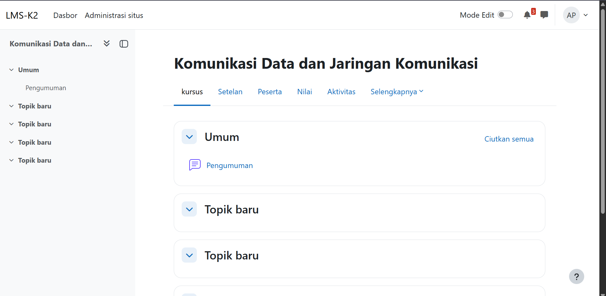

   Dosen dapat mengisi topik pada halaman mata kuliah dengan materi tertentu.
   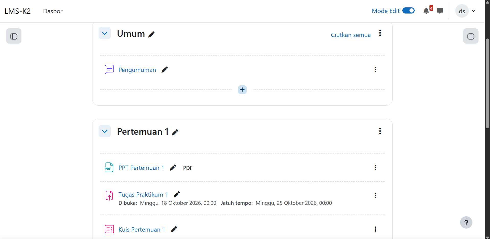

2. Materi
   Dosen dapat mengunggah berkas dengan ukuran maksimum sebesar 100 MB.
   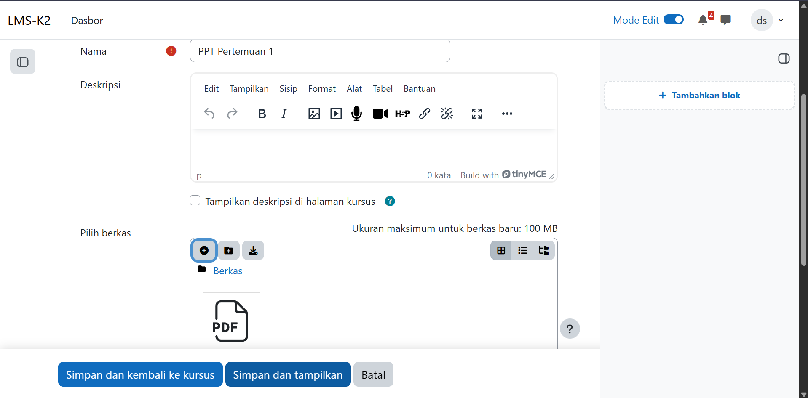

   Mahasiswa dapat membuka materi yang telah diunggah dari halaman mata kuliah.

3. Tugas
   Dosen dapat membuat tugas dengan mengisi nama dan deskripsi penugasan, lalu mengatur tanggal pengajuan dan jatuh tempo.
   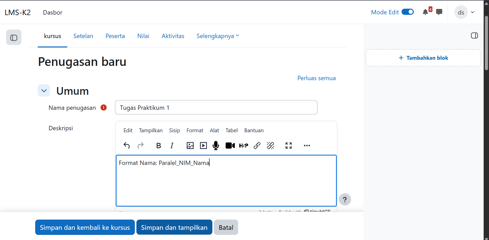

   Mahasiswa dapat mengajukan tugas dengan mengunggah pilihan berkas.
   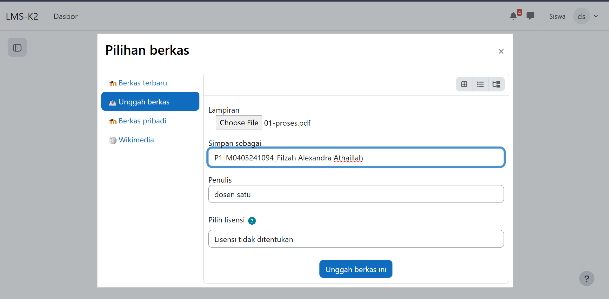

   Setelah berkas diunggah, halaman tugas menampilkan status pengajuan, status penilaian, dan waktu tersisa. Tugas yang sudah diunggah dapat diedit atau dihapus dengan *Edit pengajuan* atau *Hapus pengajuan*.
   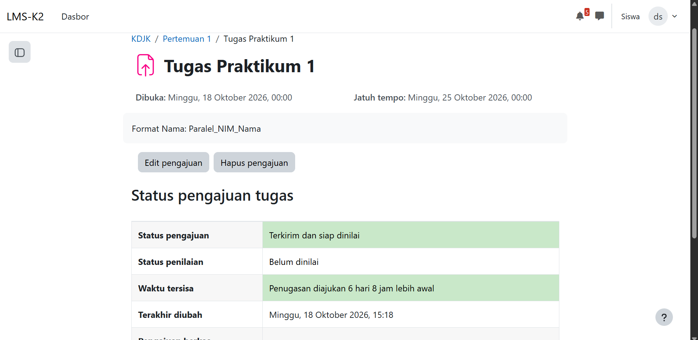

   Dosen dapat menilai tugas dengan membuka pengajuan tugas dari seorang mahasiswa. Nilai dapat diisi dengan rentang 0-100. Siswa akan mendapat notifikasi apabila kolom kabari siswa dicentang.
   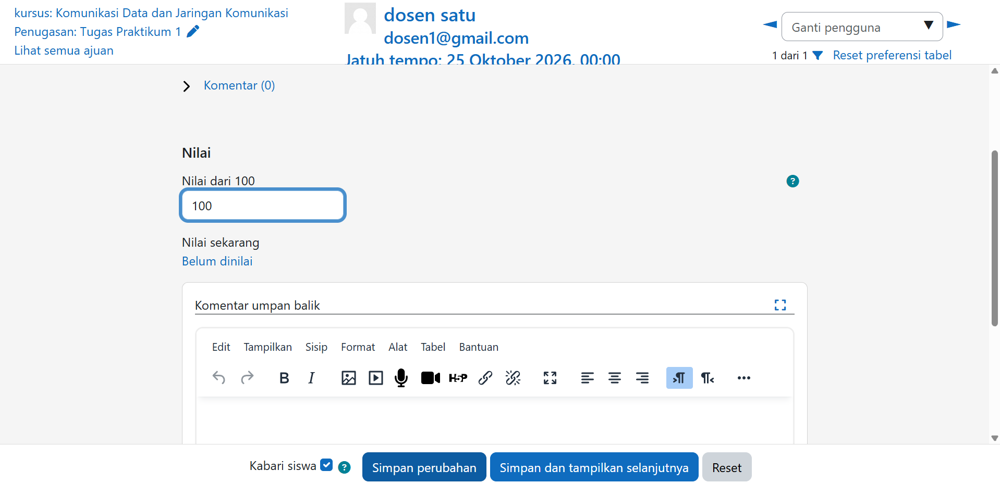

   Mahasiswa dapat melihat nilai tugas pada bagian *Umpan balik* di halaman tugas.
   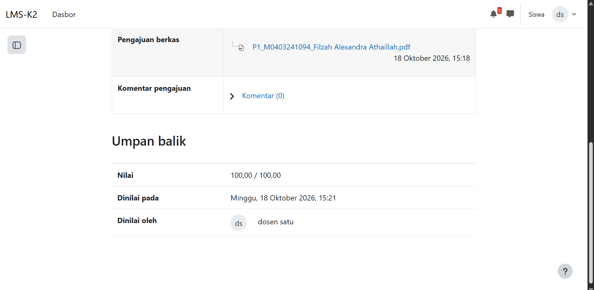

4. Kuis
   Dosen dapat membuat soal di bank soal. Soal-soal ini akan digunakan untuk menyusun kuis. Soal yang dibuat dapat memiliki tipe dan poin yang berbeda.
   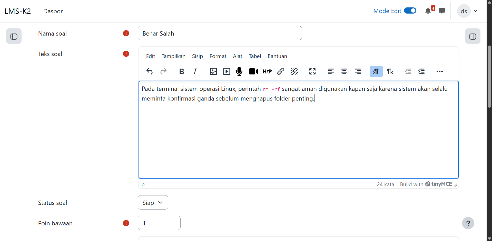
   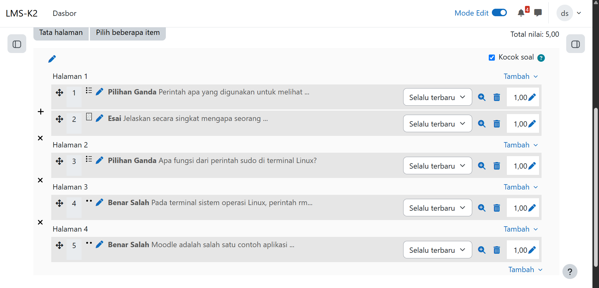

   Mahasiswa dapat membuka kuis dan menjawab soal satu per satu, lalu berpindah halaman lewat tombol *Halaman selanjutnya*.
   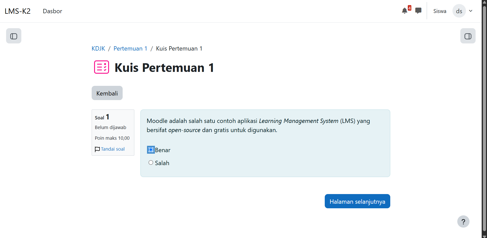

   Setelah kuis dikerjakan, mahasiswa dapat membuka halaman tinjauan yang menampilkan status, waktu mulai dan selesai, durasi, serta nilai dari kuis tersebut.
   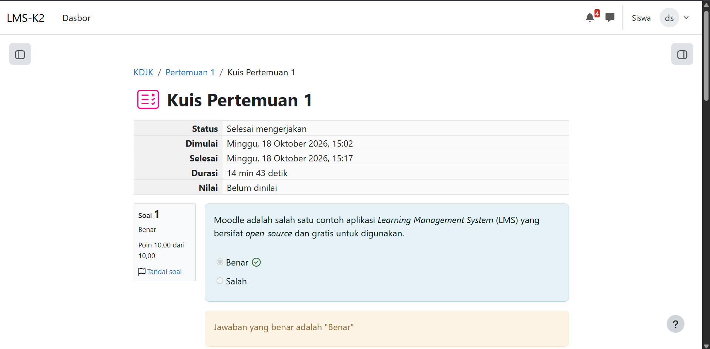

## Pembahasan

**Perbandingan dengan Aplikasi Web Sejenis**

Data Moodle diambil dari dokumentasi resmi dan pengalaman instalasi sendiri. Data Canvas LMS, Open eClass, dan ILIAS diambil dari dokumentasi dan sumber di bagian Referensi; ketiganya tidak dipasang dan dicoba langsung, dan sebagian sumber Canvas bukan dokumentasi resmi.

1. Moodle
   Fitur utama: manajemen kursus dan peserta, tugas dan kuis, forum diskusi, gradebook, dan plugin tambahan. Ekosistem plugin besar dan tersedia dalam lebih dari 100 bahasa.
   Kebutuhan hardware: disk 200 MB untuk kode Moodle ditambah ruang untuk konten (disarankan minimal 5 GB), RAM minimal 512 MB dan disarankan 1 GB atau lebih, serta prosesor minimal 1 GHz (disarankan dual-core 2 GHz). Untuk server produksi besar, disarankan RAM 8 GB atau lebih.
   Lisensi: GNU GPL v3.
   Teknologi: aplikasi PHP dengan database relasional. Pada installer Moodle 5.2.4 yang dipakai, pilihan driver meliputi MariaDB, MySQL, PostgreSQL, dan SQL Server. Moodle 5.2.4 pada instalasi ini mensyaratkan minimal PHP 8.3.0 dan MariaDB 10.11.0 (sesuai tampilan cek server).

2. Canvas LMS (Instructure)
   Fitur: mengelola kursus, pendaftaran peserta, tugas, kuis, diskusi, dan penilaian. Dikenal dengan UI yang baik dan gradebook yang kuat.
   Kebutuhan server: Ruby on Rails, PostgreSQL, Redis untuk caching, prosesor dengan minimal 4 CPU cores, disk space sebesar 40 GB hingga 50 GB storage dengan OS Ubuntu 22.04 LTS.
   Kebutuhan RAM: dibutuhkan minimal 8 GB RAM.
   Instalasi: menurut sumber yang dibaca, image Docker resmi sudah lama tidak diperbarui sehingga dibangun dari source. Butuh sertifikat SSL yang valid.
   Lisensi: AGPL-3.0.

3. Open eClass (GUnet)
   Fitur: sistem manajemen kursus untuk menyimpan dan menyajikan materi, dikembangkan jaringan akademik Yunani (GUnet) untuk e-learning asinkron.
   Kebutuhan server: PHP 8.1 (atau yang lebih baru) dan MySQL 5.7 (atau MariaDB yang setara).
   Kebutuhan RAM: tidak disebutkan dalam dokumentasi yang kami temukan.
   Instalasi: relatif ringan karena memakai stack PHP + MySQL biasa, tetapi dokumentasi dominan berbahasa Yunani.
   Lisensi: GNU GPL, open source sejak 2003.

4. ILIAS
   Fitur: konsep Personal Desktop dan Repository, akses diatur lewat role-based access control (RBAC). Mendukung SCORM 1.2 dan SCORM 2004.
   Kebutuhan server: ILIAS 10 membutuhkan PHP 8.2 atau 8.3, database MariaDB (disarankan) atau MySQL 8.0, serta web server Apache atau Nginx. Komponen opsional meliputi Java (untuk pencarian), ffmpeg, dan Ghostscript.
   Kebutuhan RAM: ukuran minimum menurut dokumentasi resmi adalah CPU dual core, RAM 4 GB, dan sekitar 25 GB untuk OS dan ILIAS. Kebutuhan naik seiring jumlah pengguna dan fitur yang aktif.
   Lisensi: GNU General Public License v3.0.
   Komunitas: berasal dari Jerman, banyak dipakai perguruan tinggi dan instansi pemerintah.

| Kriteria | Moodle | Canvas LMS | Open eClass | ILIAS |
|---|---|---|---|---|
| Bahasa/teknologi | PHP | Ruby on Rails | PHP | PHP |
| Database | MariaDB, MySQL, PostgreSQL, SQL Server | PostgreSQL (+ Redis) | MySQL/MariaDB | MySQL/MariaDB |
| Lisensi | GPL v3 | AGPL-3.0 | GPL | GPL v3 |
| Kemudahan instalasi | Sedang (pengalaman kami: banyak langkah manual pada versi 5.1 ke atas) | Sulit | Mudah sampai sedang | Sedang-Cukup sulit |
| Komunitas dan plugin | Sangat besar | Besar | Kecil | Sedang |
| Tampilan | Fungsional, makin modern | Paling modern | Sederhana | Cenderung kaku |
| Kekuatan utama | Fleksibel, plugin melimpah | UX dan gradebook | Sederhana, kebutuhan software minim | SCORM dan akses terperinci |
| RAM minimal (resmi) | 512 MB (disarankan 1 GB+) | 8 GB | Tidak ditemukan di dokumentasi | 4 GB |
| Storage awal | 5 GB | 40-50 GB | Tidak ditemukan di dokumentasi | sekitar 25 GB + konten |

**Pendapat**

RAM minimum resmi Moodle memang kecil (512 MB), tetapi untuk server produksi besar dokumentasinya menyarankan RAM 8 GB atau lebih, sehingga kebutuhan riilnya mendekati aplikasi lain. Pada proyek ini VM dan VPS masing-masing diberi 4 GB RAM, dan cukup untuk instalasi serta pemakaian dasar; belum diuji dengan banyak pengguna.

Dari pengalaman instalasi, Moodle 5.2 dari git tidak sesederhana yang tertulis pada tabel perbandingan umum. Selain stack LAMP, ada beberapa langkah tambahan yang tidak tampak jelas di awal: dependensi Composer, Apache yang harus diarahkan ke folder `public`, dan perbaikan router agar status administrasi tidak Galat. Masalah-masalah itu tercatat pada bagian Masalah yang Ditemui dan dapat diselesaikan dengan dokumentasi resmi serta forum Moodle, tetapi memakan waktu bagi pemula. Setelah terpasang, penggunaan Moodle sehari-hari (membuat mata kuliah, tugas, dan kuis) cukup jelas dilakukan lewat antarmuka web.

**Kelebihan Moodle**
- Memiliki komunitas dan plugin terbesar
- Mendukung beberapa jenis database
- Dokumentasi lengkap
- Seluruh fungsi mata kuliah, tugas, dan kuis dapat dijalankan lewat antarmuka web tanpa menulis kode
- Gratis dan berlisensi GPL v3

**Kekurangan Moodle**
- Tampilan bawaan kurang modern dibanding Canvas
- Banyak pengaturan dapat membingungkan admin baru
- Instalasi manual Moodle 5.1 ke atas membutuhkan beberapa langkah tambahan (Composer, folder `public`, konfigurasi router)

Untuk kampus atau tim kecil yang ingin hosting sendiri, Moodle paling seimbang antara fitur, kemudahan penggunaan, dan dukungan komunitas. Canvas unggul di pengalaman pengguna, tetapi pemasangan mandiri lebih berat menurut sumber yang dibaca. Open eClass cocok untuk kebutuhan sederhana, sedangkan ILIAS cocok bila butuh standar SCORM dan kontrol akses rinci.

## Referensi

- https://moodledev.io/docs/5.1/gettingstarted/requirements
- https://docs.moodle.org/503/en/Installing_Moodle
- https://docs.moodle.org/503/en/PHP
- https://docs.moodle.org/501/en/Configuring_the_Router
- https://moodle.org/mod/forum/discuss.php?d=481917
- https://ubuntu.com/download/server
- https://en.wikipedia.org/wiki/Moodle
- https://railway.com/deploy/canvas-lms
- https://gist.github.com/adeel-raza/4eb1dae869c393431df0afda6db6987d
- https://www.inmotionhosting.com/blog/server-hosting-educational-institutions-lms/
- https://elearningevolve.com/install-canvas-lms/
- https://github.com/gunet/openeclass
- https://docs.openeclass.org/el/install
- https://en.wikipedia.org/wiki/ILIAS
- https://www.ki-syndikat.de/tools/ilias/
- https://fossies.org/linux/ILIAS/docs/configuration/install.md
- https://github.com/ILIAS-eLearning/ILIAS
